<p align="center">
  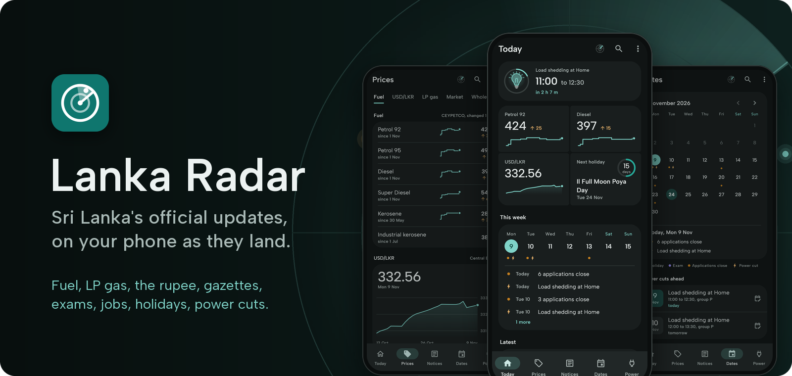
</p>

<p align="center">
  <a href="https://github.com/ThivaaVipul/lanka-radar/releases/latest"></a>
  <a href="https://github.com/ThivaaVipul/lanka-radar/actions/workflows/ci.yml"></a>
  
  <a href="LICENSE"></a>
</p>

<p align="center">
  Fuel and gas prices, the rupee, market and wholesale prices, gazettes, exams, jobs, holidays and power cuts.<br>
  Lanka Radar reads Sri Lanka's official sources every hour and tells you what changed.
</p>

<p align="center">
  <a href="https://github.com/ThivaaVipul/lanka-radar/releases/latest"><b>Download the APK</b></a>
  &nbsp;&nbsp;|&nbsp;&nbsp;
  <a href="#what-it-watches">What it watches</a>
  &nbsp;&nbsp;|&nbsp;&nbsp;
  <a href="#how-it-works">How it works</a>
  &nbsp;&nbsp;|&nbsp;&nbsp;
  <a href="docs/DEVELOPMENT.md">Build it yourself</a>
</p>

## One look, everything that changed

<table>
  <tr>
    <td align="center" width="33%">
      <picture>
        <source media="(prefers-color-scheme: dark)" srcset="docs/readme/today-dark.png">
        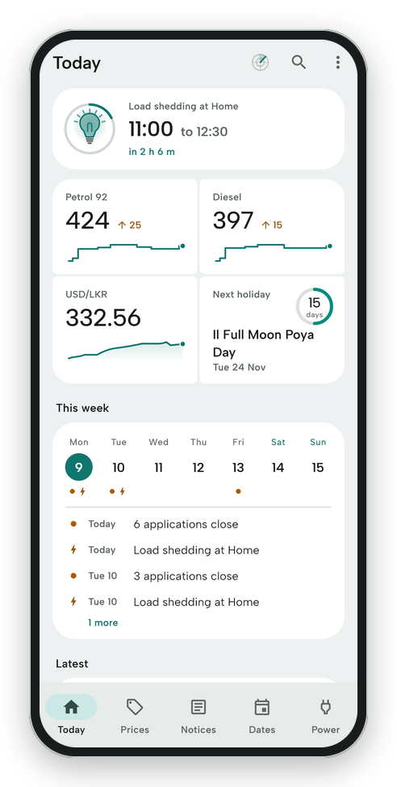
      </picture>
      <br><b>Today</b>
      <br><sub>The next power cut, the numbers that matter and the week ahead</sub>
    </td>
    <td align="center" width="33%">
      <picture>
        <source media="(prefers-color-scheme: dark)" srcset="docs/readme/prices-dark.png">
        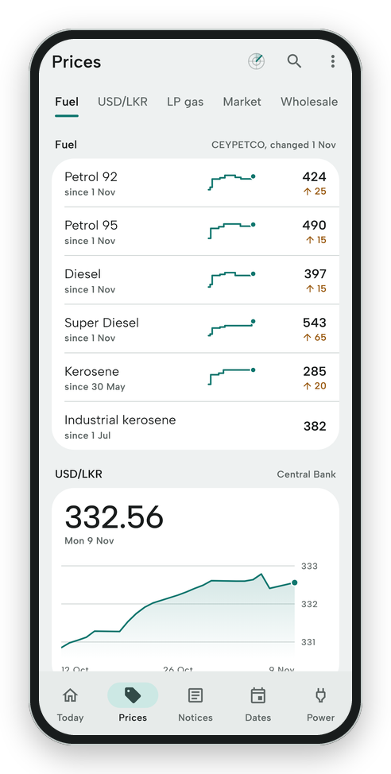
      </picture>
      <br><b>Prices</b>
      <br><sub>Fuel, USD/LKR, LP gas, market and wholesale, each with its history</sub>
    </td>
    <td align="center" width="33%">
      <picture>
        <source media="(prefers-color-scheme: dark)" srcset="docs/readme/notices-dark.png">
        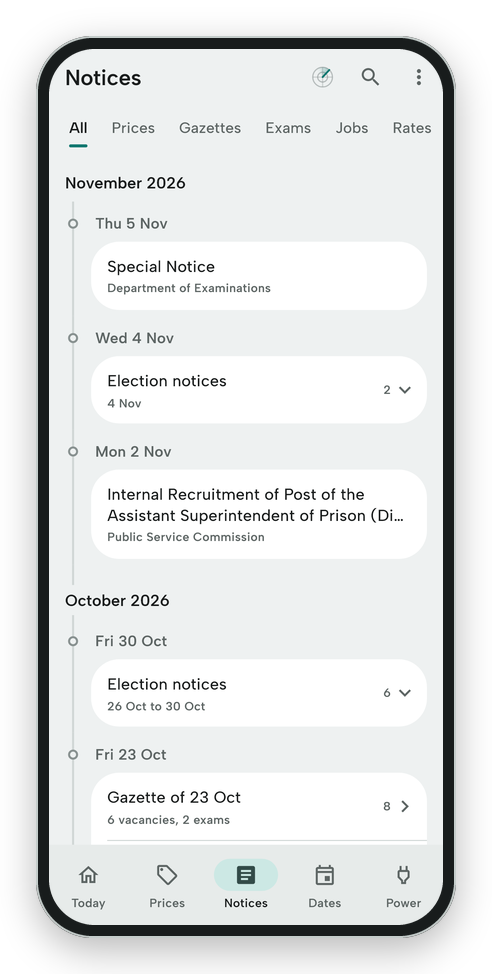
      </picture>
      <br><b>Notices</b>
      <br><sub>Gazettes, exams and jobs on a timeline, each weekly gazette folded</sub>
    </td>
  </tr>
  <tr>
    <td align="center">
      <picture>
        <source media="(prefers-color-scheme: dark)" srcset="docs/readme/dates-dark.png">
        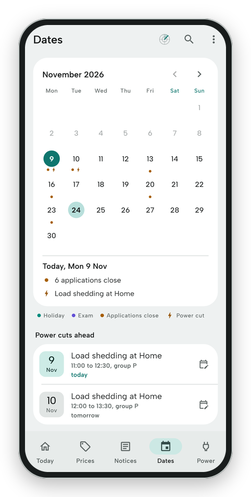
      </picture>
      <br><b>Dates</b>
      <br><sub>Holidays, exams, closing dates and power cuts on one calendar</sub>
    </td>
    <td align="center">
      <picture>
        <source media="(prefers-color-scheme: dark)" srcset="docs/readme/power-dark.png">
        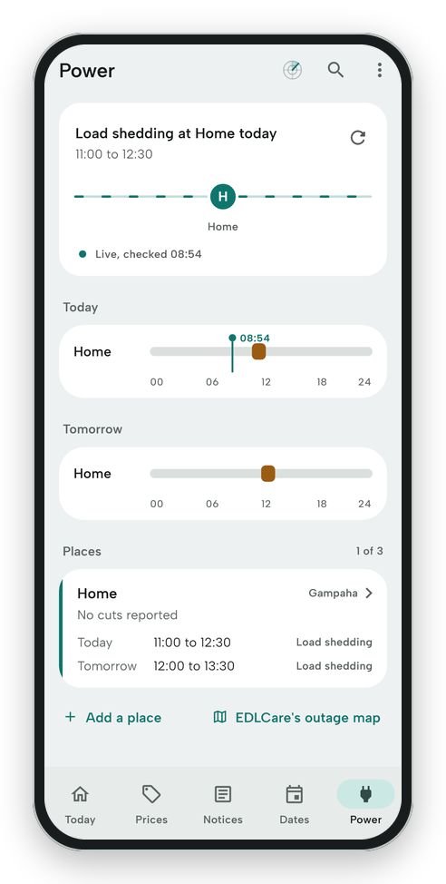
      </picture>
      <br><b>Power</b>
      <br><sub>Outages and load shedding at up to three of your places</sub>
    </td>
    <td align="center">
      <picture>
        <source media="(prefers-color-scheme: dark)" srcset="docs/readme/sources-dark.png">
        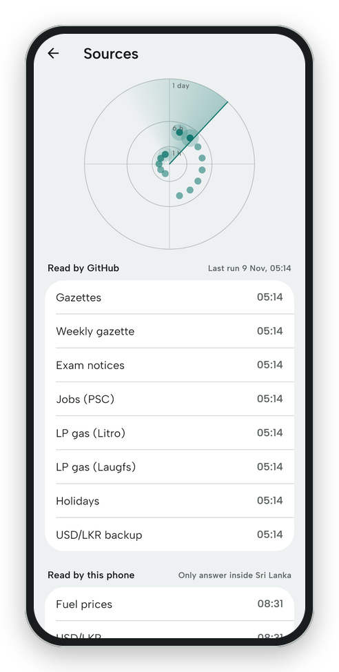
      </picture>
      <br><b>Sources</b>
      <br><sub>Every source on a radar: the nearer the centre, the fresher</sub>
    </td>
  </tr>
</table>

<p align="center"><sub>Real prices and notices from 9 November 2026. The place and its load shedding are samples. The app follows your phone's light or dark theme, as these pictures follow yours.</sub></p>

## In motion

<p align="center">
  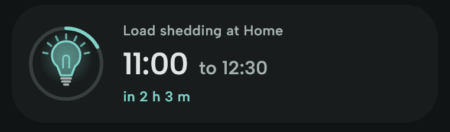
  <br><sub>The next power cut counts down on Today, its bulb lit until the power goes.</sub>
</p>

<table>
  <tr>
    <td align="center" width="50%">
      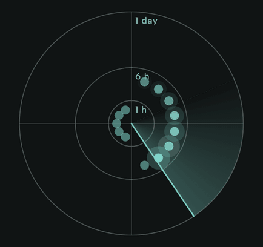
      <br><sub>The sweep: each blip is a source, lit as the sweep passes</sub>
    </td>
    <td align="center" width="50%">
      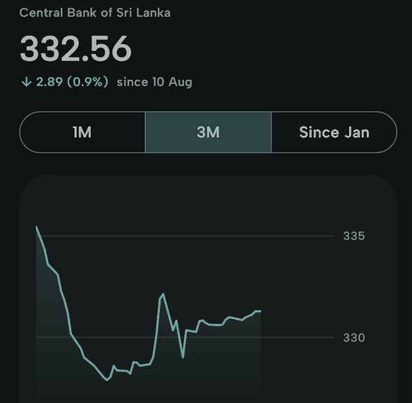
      <br><sub>Slide along any chart to read a day, with a light tick on each point</sub>
    </td>
  </tr>
  <tr>
    <td align="center">
      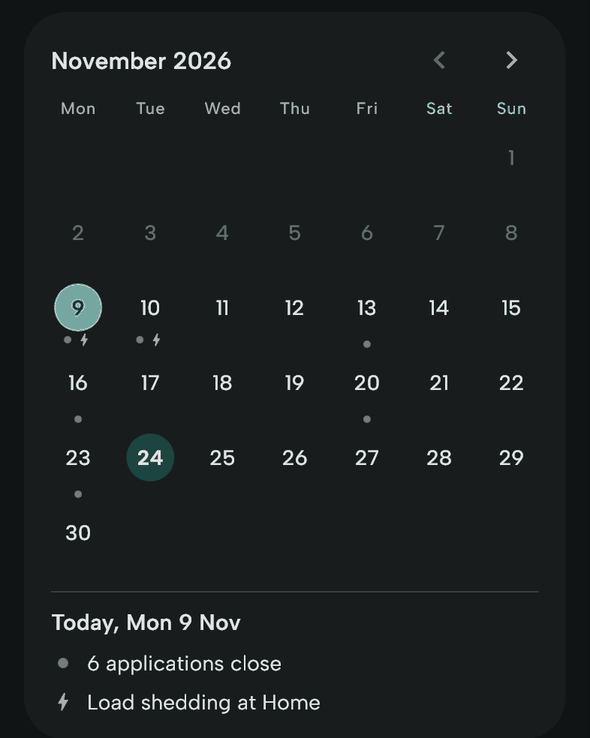
      <br><sub>Tap a day, swipe the months; long weekends show as a band</sub>
    </td>
    <td align="center">
      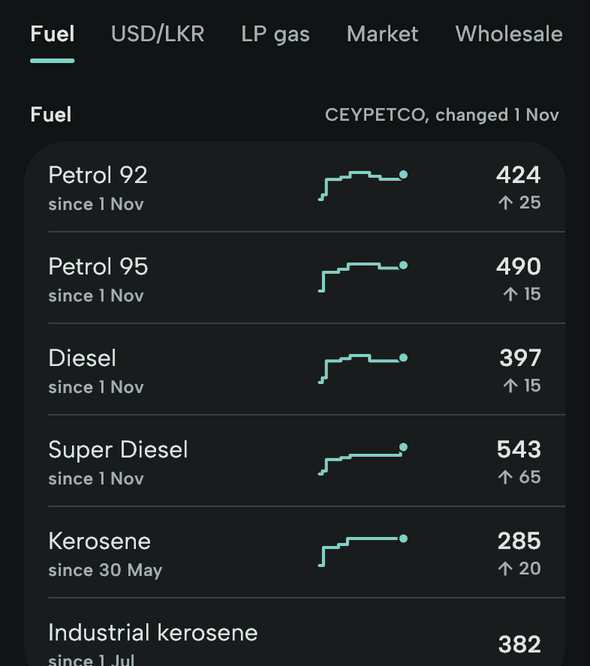
      <br><sub>Section names that jump to a section and follow the scroll</sub>
    </td>
  </tr>
</table>

## What it watches

| What | From | In the app |
| --- | --- | --- |
| Fuel prices | CEYPETCO | Every product and its history; an alert when one changes |
| USD/LKR | Central Bank of Sri Lanka | The day's rate and its last 30 days; an alert when it moves 2% in a week |
| LP gas | Litro and Laugfs | Your district's prices from both, side by side; an alert on a new list |
| Market prices | Central Bank's Daily Price Report | Everyday food at Pettah, Dambulla, Narahenpita and Negombo |
| Wholesale prices | HARTI | Vegetables at ten economic centres, rice and dried foods at Pettah |
| Gazettes | Department of Government Printing | Price orders and daily-life gazettes in English and Tamil, searchable inside |
| Vacancies and exams | The weekly gazette | Each notice with its closing date, one alert a week |
| School exams | Department of Examinations | Notices, timetables and exam days on the calendar |
| Jobs | Public Service Commission | New recruitments |
| Holidays | Public holiday calendar | Long weekends, and a reminder the evening before |
| Power cuts | CEB (EDLCare) | Outages and load shedding at your places, with 30 minutes' notice |

## How it works

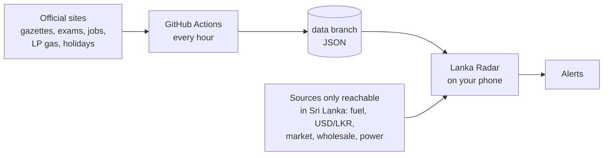

- **Every hour** a GitHub Actions workflow reads the sources and commits what changed to the `data` branch as JSON. Each gazette's PDF is read once, for its English and Tamil titles, its price tables and the text of its first pages.
- **On the phone** the app syncs with that branch in the background and reads the sources that only answer inside Sri Lanka itself. Everything stays offline: search goes inside the gazettes, and the official PDFs open in the app.
- **Alerts** are local notifications from that sync: a price change, a new gazette or exam notice, a holiday tomorrow, a power cut at your place. Each kind has its own switch, and quiet hours hold them overnight.

## Private by design

- No account, no sign-in, no ads, no analytics.
- No server of its own: just GitHub, the official sources and OpenStreetMap's tiles for the map.
- Your places stay on your phone. Sharing a power cut names the CEB area, never your place.

## Install

1. Download the APK from the [latest release](https://github.com/ThivaaVipul/lanka-radar/releases/latest). It needs Android 7.0 or newer on a 64-bit (arm64) phone.
2. Open it and allow installs from your browser or file manager when Android asks.
3. For alerts on time, set the app's battery use to **No restrictions** (on Xiaomi phones, turn on **Autostart** too).

A new release installs over the old one and keeps your data.

## Build it yourself

```bash
git clone https://github.com/ThivaaVipul/lanka-radar.git
cd lanka-radar/app
flutter pub get
flutter run
```

The scrapers, the data branch, tests and releases are in [docs/DEVELOPMENT.md](docs/DEVELOPMENT.md); the plan and every decision behind it in [docs/PLAN.md](docs/PLAN.md).

## Credits

Gazettes from the Department of Government Printing, fuel prices from CEYPETCO, LP gas prices from Litro and Laugfs, exchange rates and market prices from the Central Bank of Sri Lanka, wholesale prices from HARTI, exam notices from the Department of Examinations, recruitments from the Public Service Commission, power cuts from the CEB's EDLCare, and holidays from Google's public Sri Lanka holiday calendar. Lanka Radar is not affiliated with any of them, and every item links to its official source.

## License

MIT. See [LICENSE](LICENSE).
